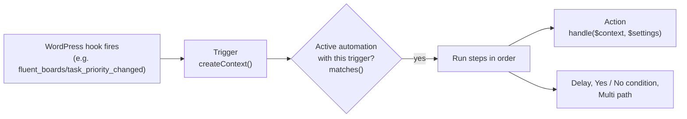

# Automations

<Badge type="tip" vertical="top" text="FluentBoards Core" /> <Badge type="warning" vertical="top" text="Intermediate" />

Automations run steps when something happens to a task: "when a task moves to Review, assign Sam and add a comment". Admins build them in **FluentBoards → Automations** on a visual canvas. Your plugin can add its own **triggers** (the events that start an automation) and **actions** (the steps it runs). They then appear in the builder next to the built-in ones, with their own settings.

This page shows how to build a trigger and an action, register them, and get them running.

## How it works



- An **automation** belongs to one board, or to every board. It has a trigger, saved trigger settings and a tree of steps. It is stored in `fbs_automations`.
- A **trigger** listens to one WordPress action hook. When the hook fires, the trigger turns its arguments into an `AutomationContext` (the task, its board and anything else the steps need). Every active automation that uses the trigger and whose settings `matches()` the event then starts a **run**.
- A **run** walks the steps. An **action** step calls your `handle()` method with the context and the settings the admin saved for that step. Delays are resumed later by Action Scheduler. Each run and its step results are stored in `fbs_automation_analytics` and shown under **All Activities**.

Built-in triggers: Task created, Task moved, Task completed, Due date changed, Assignee added, Label added, Subtask added, Comment added.
Built-in actions: Move task / Change stage, Add assignee, Apply label, Add comment, Send email, Create task from template, Duplicate task.

## Registering triggers and actions

Register from the `fluent_boards/automation_register` action. It fires once, on `init` at priority 20, after every plugin has loaded. It receives the `AutomationRegistry`.

```php
add_action('fluent_boards/automation_register', function ($registry) {
    $registry->registerTrigger(new \MyBoardsAddon\Automations\PriorityChangedTrigger());
    $registry->registerAction(new \MyBoardsAddon\Automations\SetDueDateAction());
});
```

- The name (`$triggerName` or `$actionName`) is the ID saved in automations. Keep it unique and never rename it. Prefix it with your plugin, for example `myaddon_priority_changed`. Names pass through `sanitize_key()`.
- Registering a name that already exists replaces the earlier definition, so you can override a built-in trigger or action.
- Define your classes only after FluentBoards has loaded, for example in a file you include from this callback or from `fluent_boards_loaded`. The base classes don't exist before that.
- Trigger listeners are attached only once the automation tables exist. On sites upgraded from a version without automations, an admin visit creates the tables.

## Creating a trigger

Extend `FluentBoards\App\Services\Automations\BaseTrigger`. Set the hook to listen to, then implement `getTrigger()` and `createContext()`.

```php
<?php

namespace MyBoardsAddon\Automations;

use FluentBoards\App\Models\Task;
use FluentBoards\App\Services\Automations\AutomationContext;
use FluentBoards\App\Services\Automations\BaseTrigger;

class PriorityChangedTrigger extends BaseTrigger
{
    protected $triggerName = 'myaddon_priority_changed';

    // fluent_boards/task_priority_changed passes ($task, $oldPriority)
    protected $hookName = 'fluent_boards/task_priority_changed';

    protected $actionArgNum = 2;

    /** How the trigger appears in the builder's trigger list. */
    public function getTrigger()
    {
        return [
            'category'    => __('Task', 'my-addon'),
            'title'       => __('Priority changed', 'my-addon'),
            'description' => __('Runs when a task gets a new priority.', 'my-addon'),
        ];
    }

    /** Settings shown when the trigger is selected. Keep the parent's Board field first. */
    public function getSettingsFields()
    {
        return array_merge(parent::getSettingsFields(), [
            [
                'key'         => 'priorities',
                'type'        => 'multi-select',
                'label'       => __('New priority', 'my-addon'),
                'placeholder' => __('Any priority', 'my-addon'),
                'options'     => [
                    ['id' => 'urgent', 'title' => __('Urgent', 'my-addon')],
                    ['id' => 'high', 'title' => __('High', 'my-addon')],
                    ['id' => 'medium', 'title' => __('Medium', 'my-addon')],
                    ['id' => 'low', 'title' => __('Low', 'my-addon')],
                ],
            ],
        ]);
    }

    /** Turn the hook arguments into a context; return null to ignore this event. */
    public function createContext(array $originalArgs)
    {
        $task = $originalArgs[0] ?? null;
        if (!$task instanceof Task || $task->parent_id) {
            return null; // ignore subtasks
        }

        return AutomationContext::fromTask($this->triggerName, $task, $originalArgs, [
            'old_priority' => sanitize_key($originalArgs[1] ?? ''),
        ]);
    }

    /** Whether one automation's saved settings accept this event. */
    public function matches(AutomationContext $context, array $settings)
    {
        if (!parent::matches($context, $settings)) {
            return false; // wrong board
        }

        $priorities = array_filter(array_map('sanitize_key', (array) ($settings['priorities'] ?? [])));

        return !$priorities || in_array($context->get('priority'), $priorities, true);
    }
}
```

| Member | Required | What it does |
|---|---|---|
| `$triggerName` | yes | Saved ID of the trigger |
| `$hookName` | yes | WordPress action hook to listen to |
| `$actionArgNum` | if the hook passes more than one argument | Number of hook arguments passed to `createContext()`. Default `1` |
| `$priority` | no | Hook priority. Default `20`, so FluentBoards' own listeners have finished |
| `getTrigger()` | yes | `category`, `title` and `description` for the trigger list |
| `getSettingsFields()` | no | Settings form. The parent returns the **Board** field, and keeping it lets admins limit the automation to one board |
| `getSettingsDefaults()` | no | Starting values. The parent returns `['board_id' => 0]` (any board) |
| `createContext($args)` | yes | Return an `AutomationContext`, or `null` to skip the event |
| `matches($context, $settings)` | no | Return `false` when this automation's settings don't accept the event. The parent checks the board |

Things to know:

- **Use `AutomationContext::fromTask()`.** It fills in `task`, `task_id`, `board_id`, `stage_id`, `priority`, `status` and `actor_id` (the current user). Pass your own values in the last argument and read them with `$context->get('old_priority')`.
- **Keep extra context values to scalars and arrays.** When a run waits on a delay, the context is saved without the task model and the task is reloaded when the run resumes. Objects you add are lost.
- **Never throw from a trigger.** Automations run inside the request that fired the hook, such as a user saving a task. The trigger callback catches errors and logs them with `error_log()`, so a broken trigger doesn't break that request. Still return `null` rather than throwing for events you want to skip.
- **Runs are protected against loops.** An automation never starts again for a task it is already running on in the same request. Nested runs stop after 10 levels.

## Creating an action

Extend `FluentBoards\App\Services\Automations\BaseAction`. Implement `getBlock()`, `getFields()` and `handle()`.

```php
<?php

namespace MyBoardsAddon\Automations;

use FluentBoards\App\Services\Automations\AutomationContext;
use FluentBoards\App\Services\Automations\BaseAction;
use FluentBoards\App\Services\TaskService;

class SetDueDateAction extends BaseAction
{
    protected $actionName = 'myaddon_set_due_date';

    /** How the action appears in the builder's step list. */
    public function getBlock()
    {
        return [
            'category'    => __('Task', 'my-addon'),
            'title'       => __('Set due date', 'my-addon'),
            'description' => __('Set the due date a number of days from now.', 'my-addon'),
        ];
    }

    public function getSettingsDefaults()
    {
        return ['days' => 3];
    }

    public function getFields()
    {
        return [
            [
                'key'   => 'days',
                'type'  => 'number',
                'label' => __('Days from now', 'my-addon'),
                'min'   => 1,
            ],
        ];
    }

    /**
     * Do the work. Throw to fail the step; return an array to record what happened.
     */
    public function handle(AutomationContext $context, array $settings)
    {
        $task = $context->getTask();
        $days = absint($settings['days'] ?? 0);

        if (!$task || !$days) {
            throw new \Exception(esc_html__('Task and number of days are required.', 'my-addon'));
        }

        $dueAt = gmdate('Y-m-d 23:59:59', current_time('timestamp') + $days * DAY_IN_SECONDS);
        (new TaskService())->updateTaskProperty('due_at', $dueAt, $task);

        return ['due_at' => $dueAt];
    }
}
```

| Member | Required | What it does |
|---|---|---|
| `$actionName` | yes | Saved ID of the action |
| `getBlock()` | yes | `category`, `title` and `description` for the step list. Steps are grouped by `category` |
| `getFields()` | no | Settings form for the step (see [Settings fields](#settings-fields)) |
| `getSettingsDefaults()` | no | Values a new step starts with |
| `handle($context, $settings)` | yes | Runs the step. `$settings` is what the admin saved |

Things to know:

- **Throwing fails the run.** An exception stops the run. Its message is saved as the step's error and shown in **All Activities**, so write it for the admin. Return an array (or `null`) on success. The array is stored as the step result.
- **Actions run as whoever caused the event.** That is the user who fired the trigger, or nobody when a delayed run resumes from cron. Don't depend on `current_user_can()`. If your action writes to a board or a user that comes from settings, validate it in `handle()`, the way the built-in actions check that a stage belongs to the board.
- **Use the services.** Change tasks through `TaskService`, `CommentService` and so on, so positions, activity logs, notifications and hooks stay consistent. Other automations can then react to the change. Writing to the models directly skips all of that.
- **Do slow work in the background.** The step runs inside the user's request. For an HTTP call or email, queue it with `as_enqueue_async_action()` (Action Scheduler ships with FluentBoards) and return right away. The built-in Send email action does this.
- **Smart codes.** Text fields with `'smart_codes' => true` get insert buttons for <code v-pre>{{task.title}}</code>, <code v-pre>{{stage.title}}</code>, <code v-pre>{{board.title}}</code> and others. Run the saved text through `$context->replaceSmartCodes($text)` in `handle()`.

### Helpers in `BaseAction`

| Method | Use |
|---|---|
| `boardField()` | A ready-made **Board** select. Empty means "the triggering task's board" |
| `targetBoardId($settings, $context)` | The step's board setting, or the task's board when it's empty |
| `findStage($stageId, $boardId)` | Returns the stage, or throws when the board is missing or archived, or the stage is not on it |
| `keepFields()`, `keepOptions($settings)` | The "Keep assignees, labels, subtasks, attachments, comments" switches and their `cloneTask()` options |
| `isYes($value)` | Reads a switch value (`'yes'`, `true`, `'1'`, `'on'`) |

## Settings fields

Triggers (`getSettingsFields()`) and actions (`getFields()`) describe their settings as an array of fields. The builder renders the form, and saves the values under each field's `key`.

| Key | Values |
|---|---|
| `key` | Settings key. **Required** |
| `label` | Field label |
| `type` | `text` (default), `textarea`, `number`, `select`, `multi-select`, `switch` (saves `'yes'` / `'no'`) |
| `placeholder` | Shown while empty |
| `options` | Fixed choices for `select` / `multi-select`: `[['id' => 'high', 'title' => 'High'], …]` |
| `option_key` | Load choices from the server instead: `boards`, `stages`, `labels`, `users`, `task_templates`, or your own key |
| `board_field` | For board-specific choices (stages, task templates): the key of the board field to load them from. With no board picked and an automation on every board, the select is disabled until a board is chosen. Changing the board clears it |
| `min` | Minimum for `number` |
| `smart_codes` | `true` adds smart code buttons under the field |

Select values are saved as strings of the option IDs, so cast them in PHP (`absint()`, `array_map('absint', …)`).

A board-then-stage pair, like the built-in Move task action:

```php
public function getFields()
{
    return [
        $this->boardField(),
        [
            'key'         => 'stage_id',
            'type'        => 'select',
            'option_key'  => 'stages',
            'board_field' => 'board_id',
            'label'       => __('Stage', 'my-addon'),
        ],
    ];
}

public function handle(AutomationContext $context, array $settings)
{
    $stage = $this->findStage(absint($settings['stage_id'] ?? 0), $this->targetBoardId($settings, $context));
    // ...
}
```

### Your own option lists

For an `option_key` FluentBoards doesn't know, the builder calls `GET /automations/options/{option_key}`, which applies the `fluent_boards/automation_field_options_{option_key}` filter. Return a list of `id` / `title` pairs. `$filters` holds `board_id` (the board picked in the form, or `0`) and `search`.

```php
add_filter('fluent_boards/automation_field_options_myaddon_slack_channels', function ($options, $filters) {
    return [
        ['id' => 'general', 'title' => '#general'],
        ['id' => 'releases', 'title' => '#releases'],
    ];
}, 10, 2);
```

Only FluentBoards admins can reach this endpoint.

## Smart codes

`$context->replaceSmartCodes()` fills in <code v-pre>{{task.id}}</code>, <code v-pre>{{task.title}}</code>, <code v-pre>{{task.status}}</code>, <code v-pre>{{task.priority}}</code>, <code v-pre>{{task.due_at}}</code>, <code v-pre>{{board.id}}</code>, <code v-pre>{{board.title}}</code> and <code v-pre>{{stage.title}}</code>. Add your own with `fluent_boards/automation_smart_codes`:

```php
add_filter('fluent_boards/automation_smart_codes', function ($codes, $context) {
    $codes['{{trigger.old_priority}}'] = (string) $context->get('old_priority');

    return $codes;
}, 10, 2);
```

Admins can type extra codes into any field marked `smart_codes`. The insert buttons list only the built-in codes.

## Activating an automation

A registered trigger does nothing until an **active** automation uses it.

1. Go to **FluentBoards → Automations → New Automation**. You can also start from **Templates**.
2. Pick your trigger. Choose a board, or leave **Any board**, and fill in its settings.
3. Add steps with **+**, including your action, and fill in their settings. Cards marked **Needs setup** are missing a required value.
4. Set the status pill in the top bar to **Active** and click **Save**.

Saving as Active is refused when the automation isn't ready: unfinished Yes / No or Multi path rules, invalid email recipients, or a Label added trigger with no labels. Drafts and paused automations can be saved in any state.

To turn automations on or off without opening them, use the **On / Off** switch in the list, or select rows and use the bulk **Activate** or **Pause**.

### Which triggers listen

FluentBoards keeps the list of trigger names used by active automations in the `_fluent_boards_automation_active_triggers` option. It is refreshed whenever an automation is created, deleted, or changes status or trigger. A trigger whose name isn't in that list returns at the start of its hook callback, before `createContext()` runs. So:

- An inactive trigger costs nothing on busy hooks.
- If you insert automation rows directly into the database, call `\FluentBoards\App\Hooks\Handlers\AutomationHandler::refreshActiveTriggerNames()` afterwards. Saving through the builder or the REST API does this for you.

### Testing it

1. Make the trigger's event happen. In the example above, change a task's priority on a board the automation watches.
2. Open **Automations → All Activities**. Each run shows its trigger, the steps it took, how long it took and any error message.
3. On the canvas, **Stats** shows how many tasks reached each step.

If nothing shows up:
- Check that the automation is **Active** and its board matches the task.
- Check that your `matches()` returns `true` for the event.
- Check that your callback is hooked to `fluent_boards/automation_register` before `init` priority 20.
- Check `debug.log` for a `FluentBoards automation trigger "…" failed:` line.

## Related hooks

| Hook | Type | Use |
|---|---|---|
| `fluent_boards/automation_register` | action | Register triggers and actions. Receives the `AutomationRegistry` |
| `fluent_boards/automation_field_options_{option_key}` | filter | Choices for your own `option_key` |
| `fluent_boards/automation_smart_codes` | filter | Add or change smart code values |
| `fluent_boards/automation_run_retention_days` | filter | Days to keep finished runs. Default `30`, and `0` keeps them forever. Waiting runs are never pruned |
| `fluent_boards/task_created_from_template` | action | Fired by the Create task from template action with `($newTask, $templateTask, $context)` |

## Automations with FluentCRM

To start Boards work from events outside FluentBoards, such as a WooCommerce or FluentCart order, a form submission or a contact tag, use a **FluentCRM** automation. It has those triggers, and FluentBoards adds a **Create Task** action to it that creates a task on the board and stage you choose. No code is needed.
